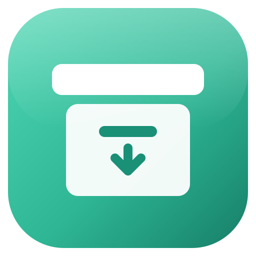

<p align="center">
  
</p>

<h1 align="center">Archivio</h1>

<p align="center">
  Große Dateimengen von externen Laufwerken sicher sortieren, prüfen und in
  eine tief verschachtelte Archivstruktur übernehmen.
</p>

<p align="center">
  <a href="https://github.com/renemfhswf/Archivio/actions/workflows/ci.yml"></a>
  
  
</p>

---

## Was ist Archivio?

Archivio ist eine Windows-Desktop-Anwendung für alle, die über Jahre
gewachsene Dateisammlungen auf externen Festplatten, USB-Sticks oder
Netzlaufwerken aufräumen möchten. Du gehst die Quellen durch, entscheidest
für jede Datei, in welchen Archivordner sie gehört, und Archivio kopiert sie
sicher dorthin.

Der Ablauf ist bewusst getrennt:

1. **Quelle ansehen** – Dateien durchsuchen, filtern und in der Vorschau
   prüfen.
2. **Ziel festlegen** – einen tief verschachtelten Archivordner auswählen und
   Dateien in die Ablage legen.
3. **Konflikte entscheiden** – Archivio erkennt identische Inhalte und
   gleichnamige Dateien, bevor irgendetwas überschrieben wird.
4. **Sicher kopieren** – Kopie über eine temporäre Datei, optionaler
   SHA-256-Vergleich, erst danach endgültiger Name.
5. **Duplikate aufräumen** – separat ganze Ordner durchsuchen und Funde
   quarantänisieren, in den Papierkorb verschieben oder endgültig löschen.

Archivio verändert **keine Quelldateien**. Gelöscht oder verschoben wird nur
im Duplikat-Bereich und nur nach einer ausdrücklichen Bestätigung.

## Funktionen

### Sortieren und ablegen

- Laufwerke, Benutzerordner und eingebundene Datenträger in der Seitenleiste
- Dateibrowser mit Filter, Sortierung nach Name, Größe, Datum und Typ
- Mehrfachauswahl per Klick, Strg, Umschalt und Tastatur
- Drag & Drop von Dateien direkt auf einen Zielordner im Baum
- Ablage (Warteschlange) mit eigener Zielwahl pro Datei
- Fortschritt pro Datei und gesamt, Abbrechen laufender Kopien
- Zusammenfassung mit kopierten, übersprungenen und fehlgeschlagenen Dateien

### Vorschau

- Bilder mit Zoom
- PDFs mit Seitenwechsel und Zoom
- Word-Dokumente (`.docx`) über `docx-preview`
- Excel-Tabellen (`.xlsx`) mit Blattwechsel
- Text- und Code-Dateien mit Zeilenumbruch
- Video und Audio
- Metadaten und Pfadaktionen (öffnen, im Explorer zeigen, Pfad kopieren)

### Konflikte und Duplikate beim Kopieren

- Prüfung auf gleichen Namen und gleichen Inhalt (Größe + SHA-256)
- Strategien: fragen, überspringen, ersetzen, automatisch umbenennen
- Einzelentscheidung oder Sammelauswahl pro Konflikt
- Automatische Namensvorschläge wie `Bericht (2).pdf`
- Fehlerhafte Dateien bleiben in der Ablage und können erneut versucht werden

### Duplikatsuche

- Beliebig viele Suchordner
- Vergleich über Dateigröße und SHA-256, nicht nur über den Namen
- Mindestgröße, versteckte Dateien und Ausschlussnamen konfigurierbar
- Gruppenansicht mit Behalten-Markierung, Vorschau und Einsparpotenzial
- Vorschläge „Älteste behalten“ und „Neueste behalten“
- Aktionen: Quarantäne, Windows-Papierkorb, endgültiges Löschen
- Endgültiges Löschen nur nach Eingabe von `LÖSCHEN`
- Export als CSV oder JSON

### Sicherheit und Nachvollziehbarkeit

- Kopien werden zuerst als temporäre Datei geschrieben und geprüft
- Vorhandene Zieldateien werden beim Ersetzen als Sicherung gehalten und bei
  einem Fehler wiederhergestellt
- SHA-256-Prüfung nach dem Kopieren standardmäßig aktiv
- Änderungsdatum bleibt standardmäßig erhalten
- Verlauf aller Kopier- und Duplikat-Aktionen
- Protokolldatei im Datenordner
- Keine Cloud, keine Telemetrie, keine Netzwerkverbindung

## Installation

Fertige Windows-Builds werden über
[GitHub Releases](https://github.com/renemfhswf/Archivio/releases) verteilt.
Dort gibt es einen Installer (NSIS) und eine portable `.exe`.

> Die Builds sind derzeit nicht code-signiert. Windows SmartScreen kann beim
> ersten Start warnen. Die Dateien stammen aus dem GitHub-Actions-Build dieses
> Repositories.

## Entwicklung

### Voraussetzungen

- Windows 10/11 (Entwicklung und Betrieb)
- Node.js 20.19 oder neuer, empfohlen Node.js 22
- npm

### Einrichtung

```bash
git clone git@github.com:renemfhswf/Archivio.git
cd Archivio
npm install
npm run dev
```

### Befehle

| Befehl | Beschreibung |
| --- | --- |
| `npm run dev` | Entwicklungsfenster mit Hot Reload |
| `npm run typecheck` | TypeScript ohne Ausgabe prüfen |
| `npm test` | Unit-Tests mit Vitest |
| `npm run test:watch` | Tests im Watch-Modus |
| `npm run build:only` | Produktions-Build nach `out/` |
| `npm run build` | Typprüfung und Produktions-Build |
| `npm run dist:win` | Windows-Installer und portable Version |
| `npm run icon` | Anwendungssymbol neu erzeugen |

Der Windows-Build landet in `release/`.

### Symbol erzeugen

Das Symbol wird aus einer SVG-Vorlage gerastert. Benötigt wird
`rsvg-convert` (librsvg):

```bash
npm run icon
```

Erzeugt `build/icon.ico`, `build/icon.png` und `build/icon.svg`.

## GitHub Actions

- **CI** (`.github/workflows/ci.yml`): Typprüfung, Tests und Build bei jedem
  Push auf `main` und bei Pull Requests.
- **Windows-Release** (`.github/workflows/release-windows.yml`): baut bei
  einem Tag `v*` oder manuell gestartet den NSIS-Installer und die portable
  Version, lädt sie als Artefakt hoch und veröffentlicht sie als
  GitHub-Release.

Ein Release auslösen:

```bash
git tag v0.1.0
git push origin v0.1.0
```

## Projektstruktur

```text
src/
  main/       Electron-Hauptprozess: Fenster, IPC, Kopieren, Duplikate
  preload/    Sichere Brücke zwischen Hauptprozess und Oberfläche
  renderer/   React-Oberfläche
  shared/     Typen und reine Hilfsfunktionen für beide Seiten
tests/        Unit-Tests für Formatierung, Namen, Duplikate und Kopieren
build/        Anwendungssymbol
scripts/      Symbolgenerator
```

Mehr Details in [docs/ARCHITEKTUR.md](docs/ARCHITEKTUR.md) und
[docs/BEDIENUNG.md](docs/BEDIENUNG.md).

## Daten und Speicherorte

- Einstellungen, Verlauf und Protokoll liegen im Electron-Datenordner, unter
  Windows typischerweise
  `%APPDATA%\Archivio` (bzw. `%APPDATA%\archivio`).
- Der genaue Pfad steht in **Einstellungen → Daten & Protokoll**.
- Temporäre Kopien tragen den Präfix `.archivio-` und werden nach Erfolg oder
  Fehler entfernt.
- Der Quarantäneordner ist frei wählbar. Voreingestellt ist
  `<Archivziel>\_Archivio-Duplikate`.

## Grenzen

- Die interne Vorschau unterstützt keine alten `.doc`-/`.ppt`-Dateien,
  Präsentationen, HEIC/TIFF und keine Archivinhalte.
- Für Netzwerkfreigaben gelten die Rechte des angemeldeten Windows-Benutzers.
- Sehr große Dateien werden vollständig gelesen, wenn die Prüfsumme aktiv ist.
  Das ist gewollt, kostet aber Zeit.

## Lizenz

[MIT](LICENSE) © 2026 Rene
